<div align="center">

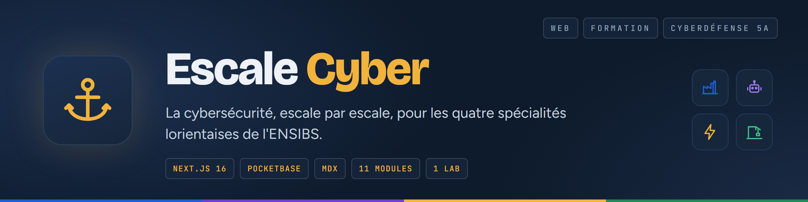

<br>

**Une plateforme web de sensibilisation à la cybersécurité, pensée pour des ingénieurs qui ne font pas de cyber.**

</div>

Sur le campus de Lorient, l'ENSIBS forme des ingénieurs en Génie Industriel, en Mécatronique, en Génie Énergétique et en Génie Civil. Ils ne feront pas de sécurité leur métier, mais leurs usines, leurs robots, leurs centrales et leurs chantiers sont désormais des systèmes d'information. Escale Cyber leur parle de leur terrain : chaque spécialité a son escale, avec ses propres histoires, et toutes partagent un tronc commun sur les mots de passe, le phishing et les mises à jour.

C'est un projet Recherche & Innovation de la filière Cyberdéfense, en 5ᵉ année, promo 2027. Notre équipe, « Prestations transversales », porte l'architecture globale et l'infrastructure de la plateforme de formation. Les équipes de chaque spécialité, elles, écrivent les modules de leur escale.


<p align="center">
<a href="#projet">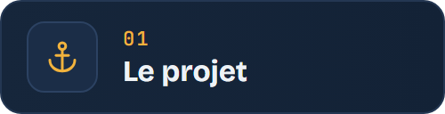</a>
<a href="#fonctionnalites">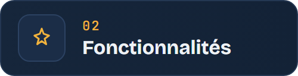</a>
<a href="#demarrer">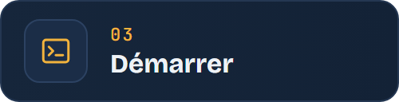</a>
<br>
<a href="#comptes">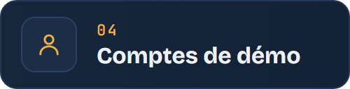</a>
<a href="#architecture">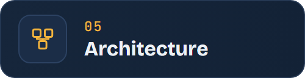</a>
<a href="#structure">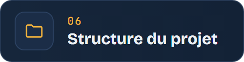</a>
<br>
<a href="#ecrire">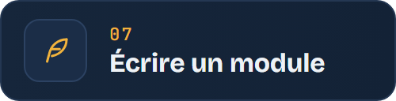</a>
<a href="#configuration">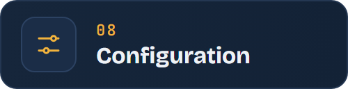</a>
<a href="#feuille-de-route">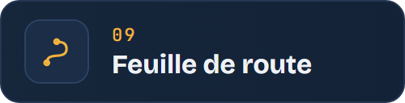</a>
</p>

<a id="projet"></a>
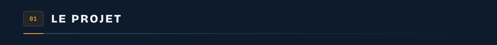

Cinq escales, une par spécialité, plus le socle commun. Un apprenant commence par le tronc commun, puis fait escale chez lui : la commande fournisseur piégée à l'usine, le firmware modifié à l'atelier, la supervision exposée à la centrale, la maquette BIM partagée sur le chantier. Rien n'empêche d'aller voir les escales des autres, et un badge le récompense.


<a id="fonctionnalites"></a>
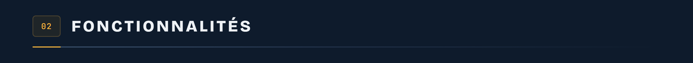

Un module se suit en quatre étapes. Le **contexte** pose la situation, sur le terrain de la spécialité. La **simulation** met l'apprenant devant le piège, le **quiz** vérifie ce qu'il en a retenu, et la **fiche réflexe** résume les gestes à garder. Une barre de progression l'accompagne d'une étape à l'autre.

Pour écrire ces étapes, les auteurs disposent de composants pédagogiques prêts à l'emploi :

- **une fausse boîte mail**, où l'apprenant classe chaque message en légitime ou phishing, avec les indices qui auraient dû l'alerter ;
- **des scénarios à embranchements**, où chaque choix mène à une suite différente, jusqu'à une bonne, une moyenne ou une mauvaise fin ;
- **des quiz** à explications, un point par bonne réponse ;
- **des fiches réflexes**, des encadrés d'astuce et d'alerte, et des **vidéos** ;
- **un lanceur de lab**, qui ouvre l'exercice pratique rattaché au module.

Onze modules d'exemple sont déjà écrits, deux ou trois par escale, pour montrer aux équipes de spécialité ce que l'on peut faire.

Le premier lab, **« L'automate au mot de passe d'usine »**, se joue à la centrale. L'IHM d'une station de pompage n'a jamais été reconfigurée, et quelqu'un s'est connecté cette nuit. L'apprenant doit s'y connecter, repérer l'action suspecte dans le journal, changer le mot de passe administrateur et prévenir la bonne personne. L'IHM de supervision est simulée dans le navigateur ; si `NEXT_PUBLIC_GUACAMOLE_URL` est défini, le lab ouvre à la place une vraie session Apache Guacamole.

Chaque apprenant a son compte, sa progression et ses points. Sept badges marquent les étapes, du premier module terminé au capitaine qui a tout bouclé, et un classement met les spécialités en concurrence. Les encadrants ont leur propre tableau de bord : des statistiques par spécialité, par module et par apprenant, pour voir ce qui est suivi et ce qui résiste.

<a id="demarrer"></a>
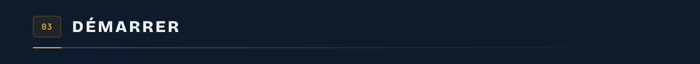

Il te faut Node.js 20 ou plus récent. Le reste s'installe tout seul.

```bash
git clone https://github.com/Cybertrist/escale-cyber.git
cd escale-cyber
npm install
npm run dev:all      # lance PocketBase (télécharge le binaire au 1er lancement) + le site
```

Tu peux aussi lancer les deux séparément, dans deux terminaux : `npm run pb`, puis `npm run dev`.

Le site répond sur <http://localhost:3000>, et l'administration de PocketBase sur <http://127.0.0.1:8090/_/>. Au premier lancement, PocketBase affiche dans le terminal un lien pour créer le compte superutilisateur. Si tu l'as manqué :

```bash
./pocketbase/pocketbase superuser upsert <email> <motdepasse>     # pocketbase.exe sous Windows
```

Pas besoin de créer les collections à la main : les migrations de `pocketbase/pb_migrations` posent le schéma et les données de démonstration au démarrage.

<a id="comptes"></a>
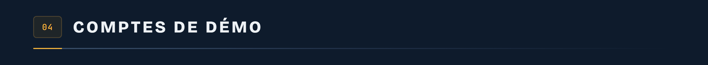

Tous les comptes de démo ont le même mot de passe, `Escale2027!`.

- `apprenant@escale.local` est en Génie Énergétique, avec une progression déjà entamée ;
- `encadrant@escale.local` ouvre le tableau de bord des encadrants ;
- les comptes `demo.*@escale.local` sont des apprenants fictifs, là pour remplir le classement et les statistiques.

Ces données sont fictives, et ne servent qu'à montrer la plateforme. Pour partir d'une base vierge, supprime `pocketbase/pb_migrations/1790000001_seed_demo.js` avant le premier lancement. Si la base existe déjà, supprime aussi `pocketbase/pb_data` : elle sera recréée au prochain démarrage, avec le schéma seul.

<a id="architecture"></a>
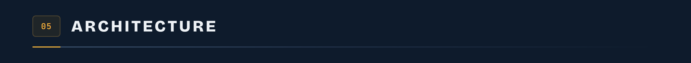

Deux briques suffisent aujourd'hui. Le site Next.js sert les pages et lit les modules, et PocketBase garde les comptes, la progression et les points dans une base SQLite. Les contenus ne sont pas dans la base : ce sont des fichiers MDX, versionnés dans Git, que les équipes de spécialité écrivent et relisent comme du code. Les labs passeront plus tard par Apache Guacamole, vers une zone isolée où tournent de vraies machines.


La pile, en quelques lignes :

- **Next.js 16**, App Router et TypeScript ;
- **MDX** avec `next-mdx-remote`, pour que les modules restent de simples fichiers texte ;
- **PocketBase 0.40**, pour l'authentification, la base SQLite et l'interface d'administration ;
- **du CSS maison**, sans framework, avec les polices Bricolage Grotesque, Figtree et JetBrains Mono.

<a id="structure"></a>
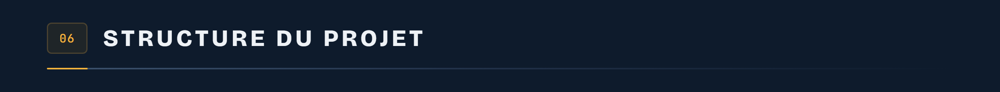

```
escale-cyber/
├── content/
│   ├── GUIDE-AUTEURS.md          guide pour les équipes de spécialité
│   └── modules/<escale>/<slug>.mdx
├── src/
│   ├── app/                      accueil, connexion, parcours, escales,
│   │                             modules, labs, encadrants
│   ├── components/module/        lecteur de module et composants pédagogiques
│   └── lib/                      escales, contenus, labs, badges, client PocketBase
├── pocketbase/pb_migrations/     schéma et données de démonstration
└── scripts/                      téléchargement de PocketBase, lancement groupé
```

<a id="ecrire"></a>
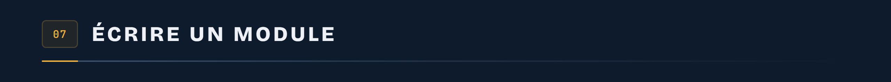

Un module est un fichier `.mdx` : du Markdown, avec quelques composants. Pas besoin de savoir coder. Il se range dans le dossier de son escale, et son nom devient son adresse : `content/modules/usine/cle-usb.mdx` s'ouvre sur `/modules/usine/cle-usb`.

En tête, un frontmatter donne le `titre`, le `resume`, la `duree` en minutes, l'`ordre` dans l'escale et, si besoin, le `lab` associé. Ensuite, **chaque titre de niveau 1 (`# ...`) devient une étape** du module.

```mdx
---
titre: La clé USB du parking
resume: Une clé USB « Salaires 2026 » traîne près de l'entrée. Tu la branches ?
duree: 10
ordre: 2
lab: poste-piege
---

# Contexte

Un matin, sur le parking de l'usine…

# Quiz

<Quiz
  questions={[
    {
      question: "Tu trouves une clé USB inconnue. Que fais-tu ?",
      choix: ["Je la branche", "Je la remets au service informatique", "Je la garde"],
      bonne: 1,
      explication: "Aucun poste n'est « sans importance » : tous sont sur le même réseau.",
    },
  ]}
/>
```

Tous les composants, la fausse boîte mail, les scénarios, les fiches et les vidéos, sont décrits pas à pas dans le [guide des auteurs](content/GUIDE-AUTEURS.md).

<a id="configuration"></a>
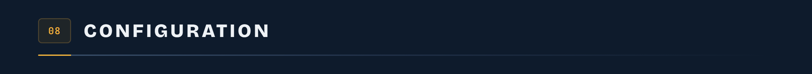

Deux variables d'environnement, à mettre dans un fichier `.env.local` à la racine :

```bash
NEXT_PUBLIC_PB_URL=http://127.0.0.1:8090   # adresse de PocketBase, c'est la valeur par défaut
NEXT_PUBLIC_GUACAMOLE_URL=                 # optionnel : les labs ouvrent une session Guacamole
```

Sans `NEXT_PUBLIC_GUACAMOLE_URL`, les labs restent simulés dans le navigateur, et la plateforme tourne sans aucune autre infrastructure.

<a id="feuille-de-route"></a>
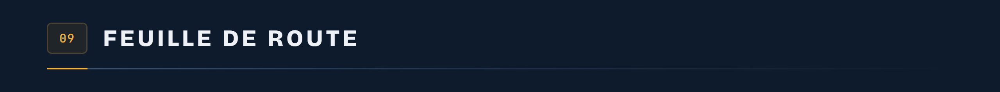

Le socle tient : les modules, les comptes, la progression et le premier lab tournent en local. La suite, sans date promise :

- de **vrais labs**, derrière Apache Guacamole, sur des machines jetables Proxmox ou Docker ;
- les labs déjà esquissés : **le poste piégé** à l'usine, **le robot distant** à l'atelier, **la caméra de chantier** sur le chantier connecté ;
- les **vidéos** des modules ;
- le **déploiement** en Docker Compose sur la VM de l'école ;
- la connexion par le **SSO universitaire**, à la place des comptes locaux.

> Escale Cyber est un projet étudiant de sensibilisation. Les entreprises, les personnes et les adresses des modules sont inventées ; les incidents cités en exemple (WannaCry, Stuxnet, Oldsmar) sont réels. Les labs ne visent que des équipements simulés.

Escale Cyber est conçu et développé par l'équipe « Prestations transversales » du projet Recherche & Innovation, filière Cyberdéfense de l'ENSIBS, promo 2027, avec les équipes de Génie Industriel, de Mécatronique, de Génie Énergétique et de Génie Civil pour les contenus.

---

<sub>Les images de cette page ne sortent d'aucun logiciel de dessin. La bannière, les bandeaux et les schémas sont des pages HTML que Chrome capture, aux couleurs de la plateforme. Tout est dans <a href="docs/tools/images.sh">docs/tools/images.sh</a>, et <code>bash docs/tools/images.sh</code> refait tout.</sub>
